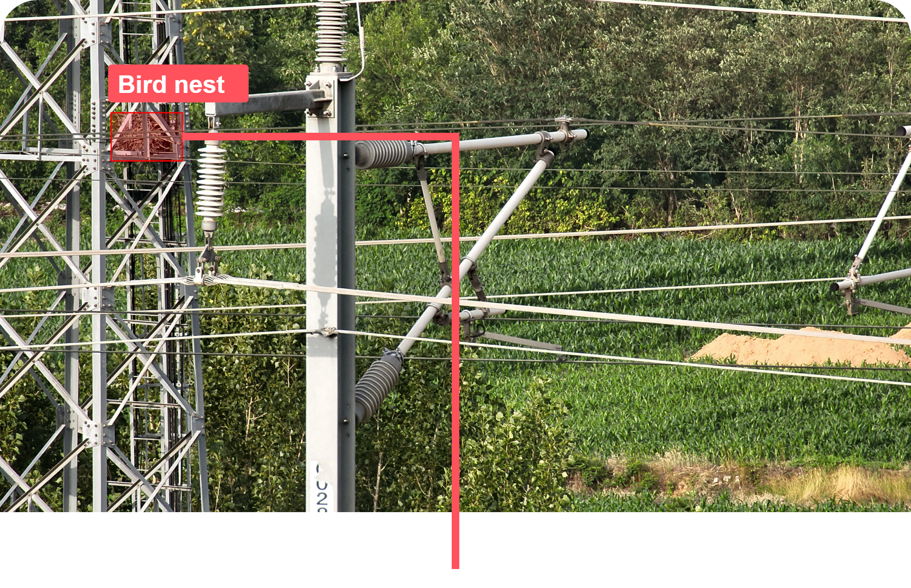
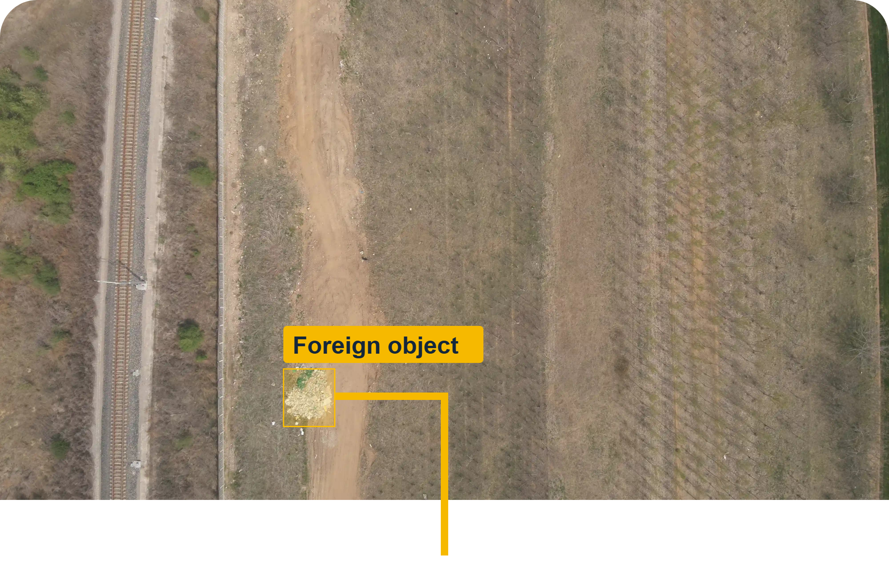
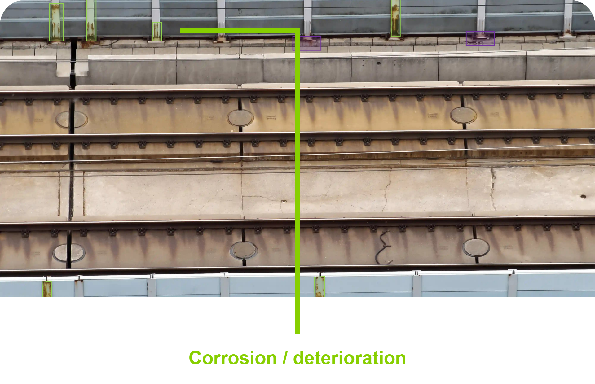
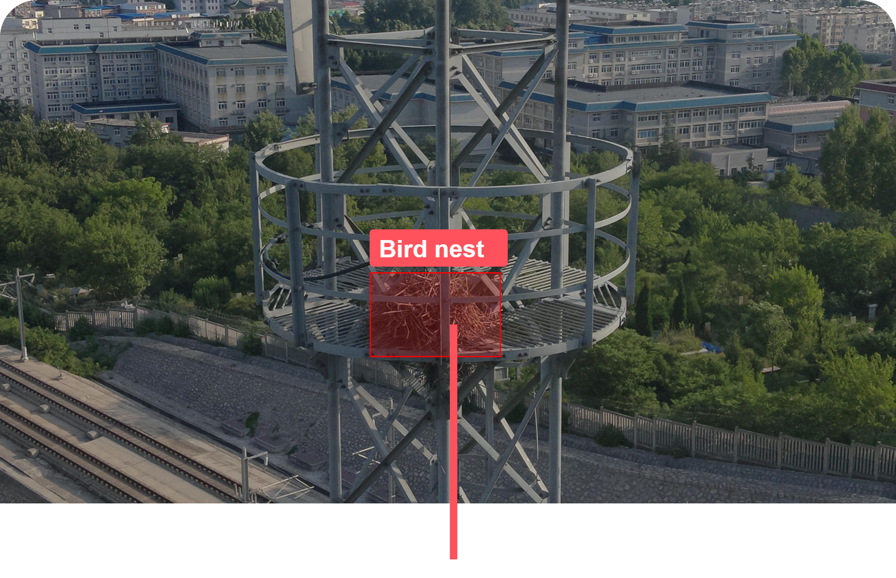
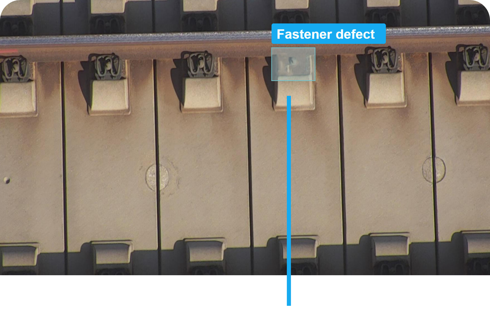
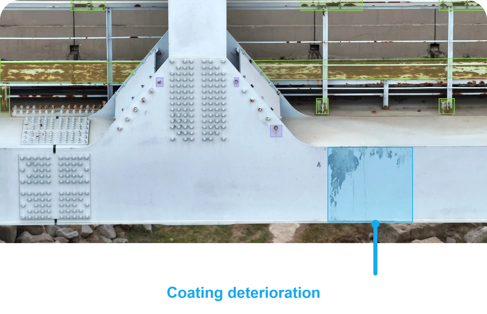
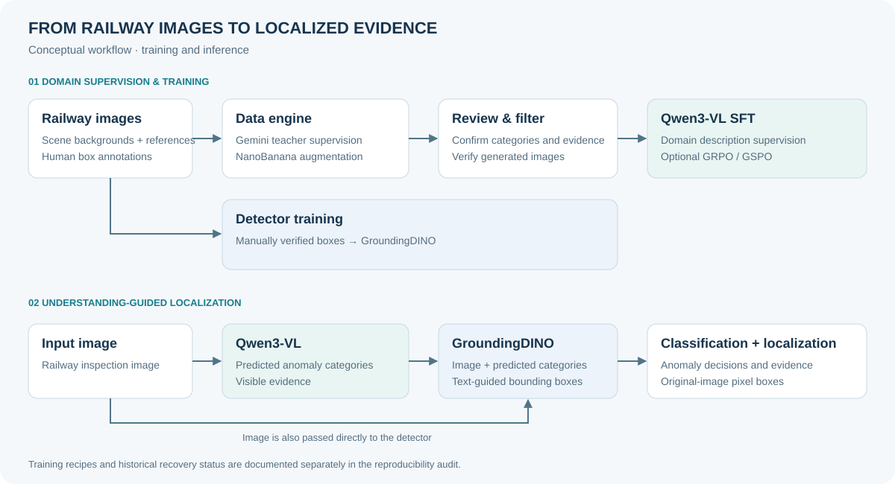
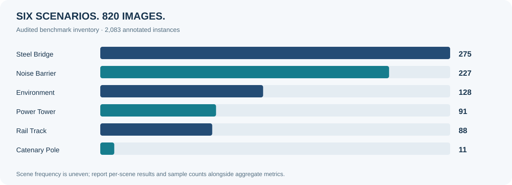

# RailMind

<div align="center">

## RailMind: Multimodal Reasoning for Railway Infrastructure Security

**Chao Ma · Zhongwei Ren · Fanteng Meng · Jingxuan Xu · Tong Meng · Xiaojie Jin · Tao Ruan · Renshuai Tao · Yong Qin · Yunchao Wei**

[](https://chaomacv.github.io/RAIL-SECURTTY-BENCH/)
[](https://chaomacv.github.io/RAIL-SECURTTY-BENCH/assets/pdf/RailMind.pdf)

<table>
<tr>
<td width="33%" valign="top" align="left">

<p>Bird nests and other attachments may compromise overhead electrical clearances. Severe intrusion can contribute to flashover and traction-power interruption.</p>
</td>
<td width="33%" valign="top" align="left">

<p>Plastic film, waste and intrusive objects may enter the track area or contact electrical equipment. Severe intrusion can disrupt train operation or power supply.</p>
</td>
<td width="33%" valign="top" align="left">

<p>Panel and column corrosion, together with deteriorated mortar, may weaken barrier integrity. Advanced damage can cause loose or falling components near the railway.</p>
</td>
</tr>
<tr>
<td width="33%" valign="top" align="left">

<p>Bird nests, foreign objects and loose antenna bolts may impair electrical clearances or attachment stability. Severe cases can involve electrical faults or falling components.</p>
</td>
<td width="33%" valign="top" align="left">

<p>Missing or cracked fasteners may weaken rail restraint and track stability. Widespread or progressive damage can pose a serious risk to safe train running.</p>
</td>
<td width="33%" valign="top" align="left">

<p>Missing bolts, coating damage and guardrail corrosion may compromise connections and durability. Advanced deterioration can threaten structural or maintenance-access safety.</p>
</td>
</tr>
</table>

</div>

*Color-matched callouts highlight defects in the existing benchmark illustrations; they are not new RailMind predictions. Safety consequences depend on defect extent and operating conditions.*

<div align="center">

[Code](https://github.com/chaomacv/RailMind) · [Documentation](docs/00_reading_guide.md) · [简体中文](README.zh-CN.md)

[Overview](#overview) · [Method](#method-overview) · [Results](#main-results) · [Benchmark](#rail-security-bench) · [Quick Start](#quick-start)

</div>

## Overview

RailMind connects **multimodal anomaly understanding** with **text-guided defect localization** for railway infrastructure inspection. Qwen3-VL identifies anomaly categories and describes visible evidence; GroundingDINO localizes the predicted categories in the image.

The research workflow combines teacher-generated supervision, same-scene image augmentation, supervised fine-tuning, and optional GRPO/GSPO post-training. This repository provides a unified CLI, prompts, configuration templates, evaluation tools, tutorials, and selected training-framework source snapshots.

- **Understand before localizing.** Use the VLM's predicted categories to guide the detector.
- **Build domain supervision.** Generate descriptions with teacher models and augment rare defects with NanoBanana, followed by human review.
- **Evaluate transparently.** Report classification and localization separately, with explicit class, scene, and instance aggregation.

> Research manuscript: *RailMind: Multimodal Reasoning for Railway Infrastructure Security*. The public release contains method code; training data, evaluation data, model weights, and the private manuscript are not included.

## Method Overview



**Training.** Gemini and other teacher models generate domain supervision. NanoBanana uses same-scene backgrounds and defect references to augment long-tailed data. Reviewed descriptions support Qwen3-VL SFT, while verified box annotations support detector training. GRPO/GSPO is an optional post-training stage.

**Inference.** A railway image is processed by Qwen3-VL to obtain anomaly categories and visual evidence. GroundingDINO receives the image and **predicted category prompts**, producing bounding boxes in original-image pixel coordinates. Ground-truth categories are not used as inference prompts.

| Component | Role | Implementation guide |
| :--- | :--- | :--- |
| Data engine | Teacher-generated scene, category, evidence, and risk descriptions | [Teacher supervision](docs/03_data_engine.md) |
| NanoBanana | Same-scene augmentation with review before training | [Augmentation](docs/04_augmentation.md) |
| Qwen3-VL SFT | Domain adaptation for anomaly understanding | [Training](docs/05_training.md) |
| GRPO / GSPO | Optional category-focused post-training | [Reinforcement learning](docs/06_rl.md) |
| GroundingDINO | Text-guided localization of predicted anomalies | [Inference & evaluation](docs/07_evaluation.md) |

The diagram summarizes the workflow; it does not establish that every historical training setting has been recovered. See the [reproducibility audit](docs/08_reproducibility.md).

## Main Results

Results reported in *RailMind: Multimodal Reasoning for Railway Infrastructure Security*:

| Task | Reported improvement | Comparison setting |
| :--- | :--- | :--- |
| Anomaly detection — mean precision | **~31%** | Over the strongest competing model, IoU = 0.5 |
| Anomaly detection — mean recall | **~19%** | Over the strongest competing model, IoU = 0.5 |
| Image-level defect classification — macro-F1 | **~37%** | Over the best same-scale open-source baseline |

RailMind uses an **8B-parameter** multimodal model. The manuscript also reports classification performance comparable to the strongest closed-source Gemini model.

**Reporting scope.** These approximate improvements follow the manuscript abstract's notation. They are not relabeled as percentage-point gains. Consult the paper's experimental tables for absolute scores, baselines, and aggregation definitions. The public workflow demo does not independently reproduce the paper's experiments.

## Rail-Security-Bench

A domain-specific benchmark for **railway infrastructure anomaly understanding and localization**, covering **six inspection scenarios** and defects involving structural degradation, missing components, and foreign-object intrusion.



| Scenario | Representative defects |
| :--- | :--- |
| Steel Bridge | Missing bolts, coating degradation, guardrail corrosion |
| Noise Barrier | Corroded panels or columns, mortar deterioration |
| Environment | Plastic film, waste, intrusive foreign objects |
| Power Tower | Bird nests, foreign objects, loose antenna bolts |
| Rail Track | Missing or cracked fasteners |
| Catenary Pole | Foreign-object attachments such as bird nests |

**Evaluation focus:** recognizing anomaly categories, explaining visible evidence, and localizing defects across railway inspection scenes. See the [evaluation protocol](docs/07_evaluation.md) and [data documentation](docs/02_data.md) for experimental details.

[Benchmark project](https://github.com/chaomacv/RAIL-SECURTTY-BENCH) · [Project website](https://chaomacv.github.io/RAIL-SECURTTY-BENCH/)

### Qualitative Results

The opening teaser reuses public benchmark illustrations. Verified RailMind prediction-versus-ground-truth comparisons are not included in this source release. For authorized local data, follow the [inference and evaluation guide](docs/07_evaluation.md) to produce predictions.

A research comparison should pair the original image, predicted category and evidence, predicted boxes, and verified ground truth; it should include failure cases as well as successful detections. The offline demo below generates synthetic workflow samples, not railway model predictions.

## Quick Start

**Python 3.10+ · CPU demo · no GPU, model weights, or API key required**

```bash
git clone https://github.com/chaomacv/RailMind.git
cd RailMind
python -m venv .venv
source .venv/bin/activate
python -m pip install -e .

python -m railmind demo --output outputs/demo
```

On Windows, activate the environment with `.venv\Scripts\Activate.ps1` in PowerShell.

The demo checks the manifest, review, SFT/RL export, augmentation planning, and evaluation workflow using generated examples. Its metrics are not paper results.

To run the repository checks:

```bash
python -m unittest discover -s tests -v
python scripts/check_release.py
```

Real model inference and training require separate environments, authorized data, and checkpoints. API and training commands preview their parameters by default; add `--execute` to perform the operation. Start with the [reading guide](docs/00_reading_guide.md).

## Documentation

| Start here | Research workflow | Evaluation & further reading |
| :--- | :--- | :--- |
| [Reading guide](docs/00_reading_guide.md) | [Teacher data engine](docs/03_data_engine.md) | [Inference & evaluation](docs/07_evaluation.md) |
| [End-to-end workflow](docs/01_workflow.md) | [NanoBanana augmentation](docs/04_augmentation.md) | [Reproducibility audit](docs/08_reproducibility.md) |
| [Data conventions](docs/02_data.md) | [SFT & detector training](docs/05_training.md) | [SFT/RL skills & tools](docs/09_sft_rl_skills_and_community.md) |
| [中文项目说明](README.zh-CN.md) | [GRPO / GSPO](docs/06_rl.md) | [Post-training paper roadmap](docs/10_post_training_paper_roadmap.md) |

The detailed tutorials currently use Chinese.

<details>
<summary><strong>Repository map</strong></summary>

| Path | Contents |
| :--- | :--- |
| `railmind/` | Unified workflow CLI and adapters |
| `configs/` | SFT, RL, and detector recipes |
| `prompts/` | Teacher and augmentation prompts |
| `training/` | Railway reward plugin |
| `third_party/` | Selected framework snapshots and upstream licenses |
| `tests/` | Workflow and evaluation regression tests |
| `docs/` | Tutorials, inventory, and reproduction boundaries |

</details>

## Availability & Citation

- **Code:** available in this repository; licensing of the new workflow code is pending author selection.
- **Data:** training/evaluation images, annotations, supervision samples, manifests, split IDs, and subset IDs are not distributed.
- **Models:** model weights are not distributed.
- **Paper & citation:** final publication URL and BibTeX are pending. Use the final publication record when available.

See [NOTICE.md](NOTICE.md) for source attribution and release scope. Third-party code retains its respective licenses.

## Acknowledgments

RailMind builds on Qwen3-VL, Gemini, NanoBanana, GroundingDINO, the Open-GroundingDino implementation by Zuwei Long and Wei Li, LLaMA-Factory, and ms-swift. Upstream source details are recorded in [third_party/source_lock.json](third_party/source_lock.json).

---

<div align="center">
<strong>RailMind</strong><br>
Multimodal understanding and localization for railway infrastructure inspection.
</div>
