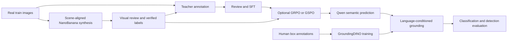

# RailMind

**Multimodal reasoning and visual grounding for railway infrastructure inspection.**

[中文指南](README.zh-CN.md) · [Workflow](docs/01_workflow.md) · [SFT/RL skill map](docs/09_sft_rl_skills_and_community.md) · [post-training paper roadmap](docs/10_post_training_paper_roadmap.md) · [Reproducibility](docs/08_reproducibility.md) · [Source inventory](docs/source_inventory.json)

RailMind separates **what is wrong** from **where it is**: a railway-adapted Qwen3-VL model predicts anomaly categories and visible evidence; a fine-tuned GroundingDINO detector provides spatial localization. A teacher data engine and scene-aligned NanoBanana augmentation supply training data, with optional category-reward RL after SFT.

This repository is a curated research release, not a copy of the experiment server. It includes portable data tools, prompts, reviewed-data exports, training recipes, source-matched framework snapshots and explicit evaluation protocols. It does not ship private data or model weights.



## Quick Start: No GPU Or API Key

Run from the cloned repository, using Python 3.10 or newer:

```bash
python -m venv .venv
source .venv/bin/activate
python -m pip install -e .
railmind demo --output outputs/demo
python -m unittest discover -s tests -v
python scripts/check_release.py
```

The demo builds two procedural schematic images, a hashed manifest, mock teacher/review records, SFT/RL exports, augmentation tasks and detection metrics. It makes **no API calls** and performs **no training**. Its scores are fixture checks, not research results. Use a fresh output directory when rerunning.

The core package has no third-party runtime dependencies. `python -m railmind` also works directly from the source checkout. Pillow is optional for downloading and inspecting generated images; GPU training uses separate framework environments.

## Use Your Own Data

1. Build manifests with explicit train/val/test splits: [Data](docs/02_data.md).
2. Generate and review teacher annotations: [Data engine](docs/03_data_engine.md).
3. Generate scene-aligned synthetic defects and verify the results: [NanoBanana](docs/04_augmentation.md).
4. Export reviewed SFT and box-supervised datasets, then train both components: [Training](docs/05_training.md).
5. Optionally export verified synthetic category labels and apply RL: [RL](docs/06_rl.md).
6. Run semantic prediction, grounding and evaluation: [Inference and evaluation](docs/07_evaluation.md).
7. Use the post-training skill map to understand SFT/RL concepts, community tooling and common failure modes: [SFT/RL skill map](docs/09_sft_rl_skills_and_community.md).
8. Read the paper roadmap and curve-reading guide before tuning LR, KL, batch size or rollout settings: [post-training paper roadmap](docs/10_post_training_paper_roadmap.md).

All API and training commands default to **dry-run**. Add `--execute` only when the configured service/environment is ready. Secrets are read from environment variables. API outputs remain unapproved until an explicit review decision is applied.

## Dataset Versions: 820 Is Present

The server directory named `810_test_modified` actually contains **820 image files**, **820 COCO image records** and **2,083 instance annotations**, with no missing referenced images. Scene counts match the manuscript: steel bridge 275, rail track 88, environment 128, catenary pole 11, noise barrier 227, power tower 91. Image IDs 811-820 are ten additional catenary-pole images.

Use the full 820-image manifest for the documented benchmark. An explicit 810-ID subset can be derived for comparison, but its historical annotation version was not independently recovered. Never select a test set based on its folder name. Keep subset IDs and annotation hashes with every result.

## Experiment Profiles

| Profile | Data | Status |
|---|---|---|
| Manuscript Qwen SFT | 20,931 instruction samples | Reconstructed recipe; exact historical launch missing |
| Server Qwen LoRA SFT | 24,265 samples, including 3,334 box-output samples | Adapted from offline reproduction bundle |
| Detector train2 | 3,334 images | Source-matched training code and config |
| Manuscript RL | 3,134 prompts, 16 generations | Category reward and GRPO/GSPO recipes reconstructed |

The manuscript and server SFT profiles are **different experiments**. Keep descriptive SFT and direct box-output SFT separate in ablations. A release smoke test does not reproduce the manuscript tables. See [known gaps](docs/08_reproducibility.md).

## Layout

```text
railmind/       CLI, schemas, API adapter, augmentation, exports, rewards, evaluation
configs/        Separate SFT/RL profiles and source-matched detector config
prompts/        Teacher, semantic and 13 defect-generation prompts
training/       ms-swift category-reward plugin
third_party/    Selected source snapshots, licenses and per-file hashes
docs/           End-to-end guides, audit evidence and reproducibility boundaries
tests/          CPU regression tests, including leakage and malformed outputs
scripts/        Release assembly and payload checks
.env.example    Credential-free environment template
```

## Paper And Citation

This release corresponds to the user-supplied draft *RailMind: Multimodal Reasoning for Railway Infrastructure Security*. The manuscript includes supervised fine-tuning, optional GRPO/GSPO, NanoBanana augmentation, six railway scenes and 13 anomaly categories. Publication status and final bibliography are not asserted by this repository.

```bibtex
@misc{railmind_draft,
  title = {RailMind: Multimodal Reasoning for Railway Infrastructure Security},
  author = {Ma, Chao and Ren, Zhongwei and Meng, Fanteng and Xu, Jingxuan and Meng, Tong and Ruan, Tao and Tao, Renshuai and Qin, Yong and Wei, Yunchao},
  note = {Research manuscript; update with the final publication record}
}
```

The project license for newly organized code is pending author selection. Third-party licenses are preserved. See [NOTICE](NOTICE.md) and [release checklist](docs/08_reproducibility.md).

## Data publication policy

All training and evaluation datasets are withheld, including images, annotations, generated supervision, manifests, and split/subset ID lists. This repository publishes method code, generic prompts, configuration templates, and documentation only. The offline demo generates fictional fixtures at runtime.
