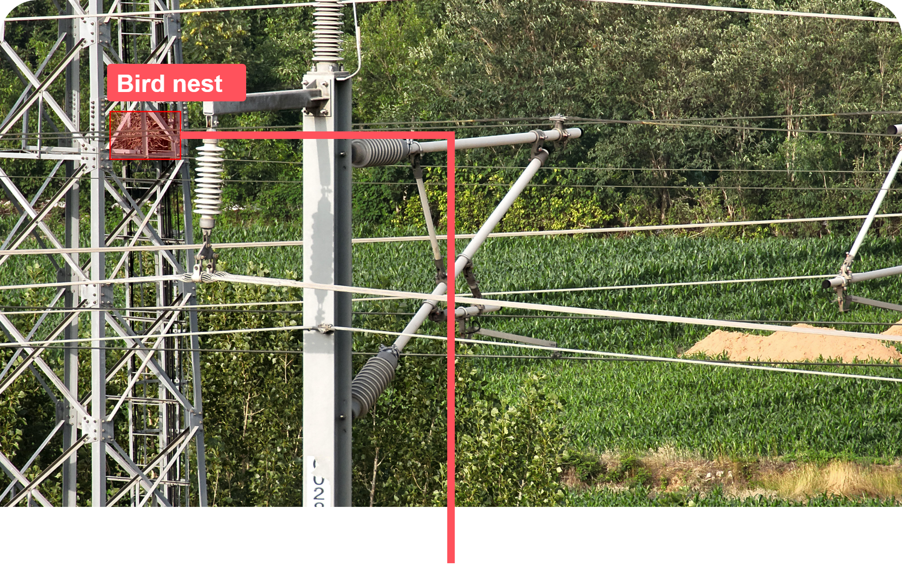
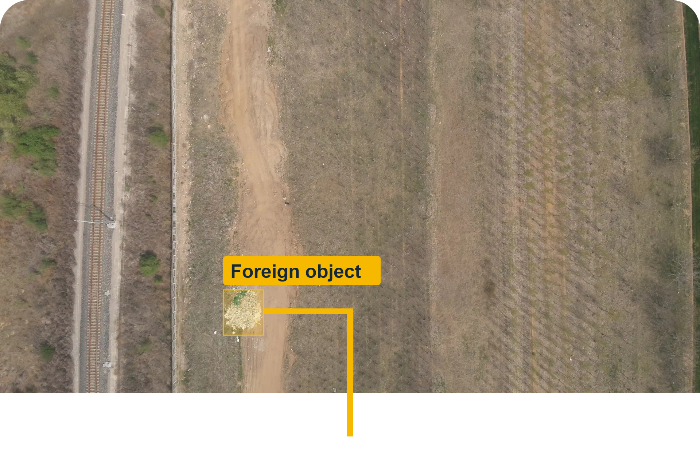
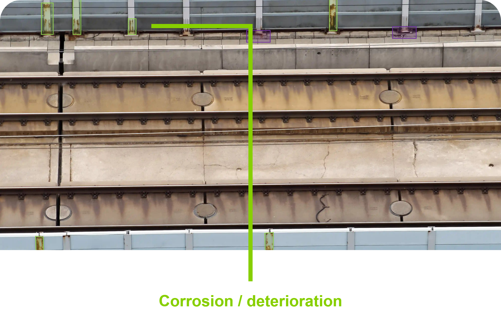
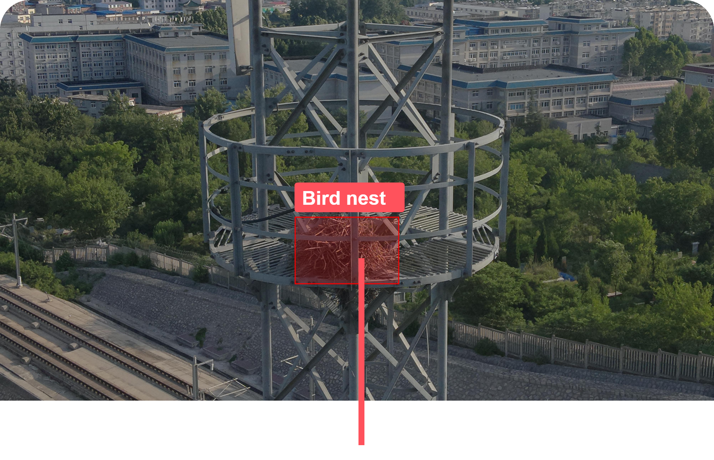
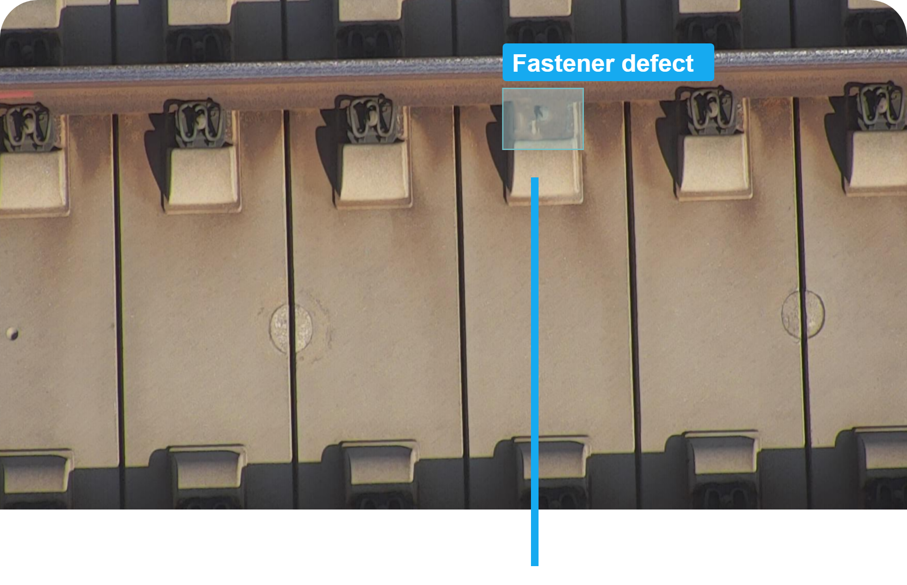
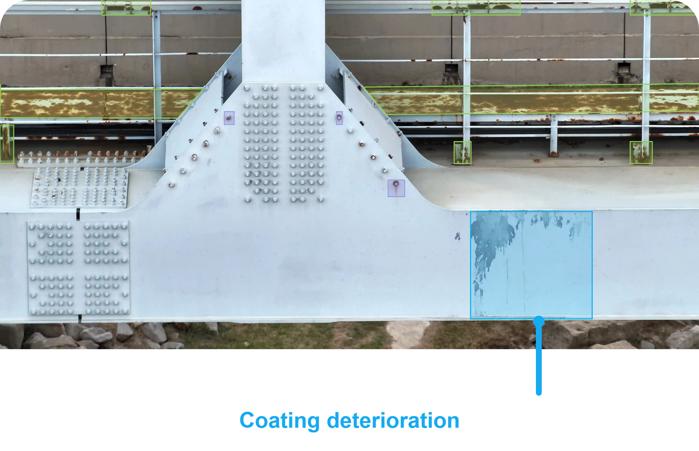
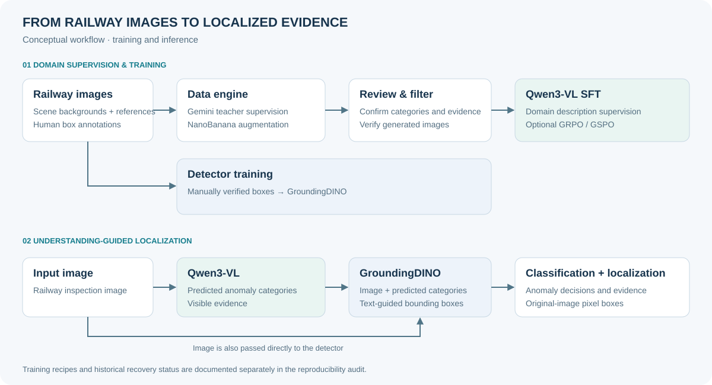
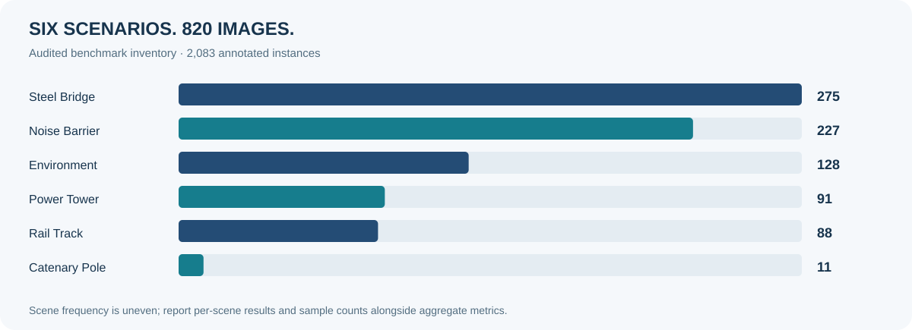

# RailMind

<div align="center">

## RailMind: Multimodal Reasoning for Railway Infrastructure Security

**Chao Ma · Zhongwei Ren · Fanteng Meng · Jingxuan Xu · Tong Meng · Xiaojie Jin · Tao Ruan · Renshuai Tao · Yong Qin · Yunchao Wei**

[](https://chaomacv.github.io/RAIL-SECURTTY-BENCH/)
[](https://chaomacv.github.io/RAIL-SECURTTY-BENCH/data-engine/)

<table>
<tr>
<td width="33%" valign="top" align="left">

<p>鸟巢等附着异物可能侵占电气安全间隙，影响接触网供电安全；严重侵入时可能引发闪络或牵引供电中断。</p>
</td>
<td width="33%" valign="top" align="left">

<p>塑料薄膜、堆积垃圾等异物可能侵入轨道区域或接触电气设备；严重侵入时可能影响列车运行或电力供应。</p>
</td>
<td width="33%" valign="top" align="left">

<p>面板与立柱腐蚀、砂浆劣化可能削弱结构完整性；损伤进一步发展时，可能导致邻近线路的部件松动或坠落。</p>
</td>
</tr>
<tr>
<td width="33%" valign="top" align="left">

<p>鸟巢、异物及天线螺栓松动可能影响电气间隙或附属部件稳定性；严重时可能引发电气故障或部件坠落。</p>
</td>
<td width="33%" valign="top" align="left">

<p>扣件缺失或开裂可能削弱钢轨约束和轨道稳定性；大范围或持续发展的损伤可能严重威胁列车运行安全。</p>
</td>
<td width="33%" valign="top" align="left">

<p>螺栓缺失、涂层损伤和护栏腐蚀可能削弱连接可靠性与结构耐久性；严重劣化时可能危及结构或检修通行安全。</p>
</td>
</tr>
</table>

</div>

*彩色标注用于突出已有基准示例中的异常，并非新增的 RailMind 预测结果。安全影响取决于缺陷程度及实际运行条件。*

<div align="center">

[代码](railmind/) · [文档](docs/zh-CN/00_reading_guide.md) · [English](README.md) · **简体中文**

[项目概述](#项目概述) · [方法架构](#方法架构) · [主要结果](#主要结果) · [基准评测](#rail-security-bench) · [快速开始](#快速开始)

</div>

## 项目概述

RailMind 面向铁路基础设施巡检，将**多模态异常理解**与**文本引导的缺陷定位**结合起来。Qwen3-VL 识别异常类别并描述可见证据，GroundingDINO 根据预测类别定位图像中的缺陷。

研究流程包括教师模型生成监督、同场景图像增强、监督微调，以及可选的 GRPO/GSPO 后训练。仓库提供统一 CLI、提示词、配置模板、评测工具、分阶段教程和部分训练框架源码快照。

- **先理解，再定位。** 使用视觉语言模型预测的异常类别引导检测器。
- **构建领域监督。** 由教师模型生成描述，使用 NanoBanana 补充长尾缺陷，并经过人工审核。
- **明确评测口径。** 分别报告分类与定位结果，区分类别、场景及实例层面的汇总指标。

> 对应论文：*RailMind: Multimodal Reasoning for Railway Infrastructure Security*。仓库提供方法代码；训练数据、评测数据和模型权重不随源码发布。

## 方法架构



**训练阶段。** Gemini 等教师模型生成领域监督。NanoBanana 使用同场景背景与缺陷参考图补充长尾样本。审核后的描述用于 Qwen3-VL SFT，经确认的框标注用于检测器训练；GRPO/GSPO 是可选的后训练阶段。

**推理阶段。** Qwen3-VL 从铁路图像中输出异常类别与可见证据。GroundingDINO 接收图像和**预测类别提示**，输出原图像素坐标中的检测框。推理提示不使用测试真值类别。

| 组件 | 作用 | 使用指南 |
| :--- | :--- | :--- |
| 数据引擎 | 生成场景、类别、可见证据与风险描述 | [教师监督](docs/zh-CN/03_data_engine.md) |
| NanoBanana | 同场景增强，审核后进入训练 | [数据增强](docs/zh-CN/04_augmentation.md) |
| Qwen3-VL SFT | 面向铁路异常理解的领域适配 | [模型训练](docs/zh-CN/05_training.md) |
| GRPO / GSPO | 可选的类别决策后训练 | [强化学习](docs/zh-CN/06_rl.md) |
| GroundingDINO | 根据预测异常类别进行文本引导定位 | [推理与评测](docs/zh-CN/07_evaluation.md) |

架构图概括研究流程，历史训练设置的恢复情况详见[复现审计](docs/zh-CN/08_reproducibility.md)。

## 主要结果

以下为论文 *RailMind: Multimodal Reasoning for Railway Infrastructure Security* 报告的研究结果：

| 任务 | 报告的提升 | 对比设置 |
| :--- | :--- | :--- |
| 异常检测：平均精确率 | **约 31%** | 相比最强对比模型，IoU = 0.5 |
| 异常检测：平均召回率 | **约 19%** | 相比最强对比模型，IoU = 0.5 |
| 图像级缺陷分类：macro-F1 | **约 37%** | 相比同规模最优开源基线 |

RailMind 使用 **8B 参数**多模态模型。论文同时报告，其分类性能与最强闭源 Gemini 模型具有可比性。

**结果口径。** 上述近似提升沿用论文摘要的百分比表述，不改写为百分点增益。绝对分数、对比模型和平均方式以论文实验表为准；公开工作流 Demo 不构成对论文实验的独立复现。

## Rail-Security-Bench

面向**铁路基础设施异常理解与定位**的领域基准，覆盖**六类巡检场景**，关注结构劣化、部件缺失与异物侵入等缺陷。



| 场景 | 典型缺陷 |
| :--- | :--- |
| 钢桥 | 螺栓缺失、涂层劣化、护栏腐蚀 |
| 声屏障 | 面板或立柱腐蚀、砂浆劣化 |
| 周边环境 | 塑料薄膜、堆积垃圾、侵入异物 |
| 电力塔 | 鸟巢、异物、天线螺栓松动 |
| 轨道 | 扣件缺失或开裂 |
| 接触网杆 | 鸟巢等附着异物 |

**评测重点：**识别异常类别、解释可见证据，并在铁路巡检场景中定位缺陷。实验细节见[评测协议](docs/zh-CN/07_evaluation.md)和[数据文档](docs/zh-CN/02_data.md)。

[基准项目](https://github.com/chaomacv/RAIL-SECURTTY-BENCH) · [项目网站](https://chaomacv.github.io/RAIL-SECURTTY-BENCH/)

### 定性结果

首页图片沿用已公开的基准示例。当前源码发布中不包含经过核验的 RailMind 预测与真值对比案例。使用获得授权的本地数据时，可按[推理与评测指南](docs/zh-CN/07_evaluation.md)生成预测。

定性比较应同时展示原图、预测类别与证据、预测框和经确认的真值，并包含成功与失败案例。下方离线 Demo 生成的是虚构工作流样例，不是真实铁路模型预测。

## 快速开始

**Python 3.10+ · CPU Demo · 无需 GPU、模型权重或 API Key**

```bash
git clone https://github.com/chaomacv/RailMind.git
cd RailMind
python -m venv .venv
source .venv/bin/activate
python -m pip install -e .

python -m railmind demo --output outputs/demo
```

Windows 用户可在 PowerShell 中使用 `.venv\Scripts\Activate.ps1` 激活环境。

Demo 使用程序生成的示例，检查图像清单、审核、SFT/RL 数据导出、增强规划和评测流程。其输出指标不是论文结果。

运行仓库检查：

```bash
python -m unittest discover -s tests -v
python scripts/check_release.py
```

真实推理与训练需要单独配置环境、授权数据和模型权重。API 与训练命令默认预览参数，加 `--execute` 才实际执行。完整说明从[阅读指南](docs/zh-CN/00_reading_guide.md)开始。

## 文档导航

| 入门 | 研究流程 | 评测与扩展阅读 |
| :--- | :--- | :--- |
| [阅读指南](docs/zh-CN/00_reading_guide.md) | [教师数据引擎](docs/zh-CN/03_data_engine.md) | [推理与评测](docs/zh-CN/07_evaluation.md) |
| [完整工作流](docs/zh-CN/01_workflow.md) | [NanoBanana 数据增强](docs/zh-CN/04_augmentation.md) | [复现审计](docs/zh-CN/08_reproducibility.md) |
| [数据规范](docs/zh-CN/02_data.md) | [SFT 与检测器训练](docs/zh-CN/05_training.md) | [SFT/RL 技能与工具](docs/zh-CN/09_sft_rl_skills_and_community.md) |
| [English README](README.md) | [GRPO / GSPO](docs/zh-CN/06_rl.md) | [后训练论文路线](docs/zh-CN/10_post_training_paper_roadmap.md) |

<details>
<summary><strong>仓库结构</strong></summary>

| 路径 | 内容 |
| :--- | :--- |
| `railmind/` | 统一工作流 CLI 与适配器 |
| `configs/` | SFT、RL 和检测器训练配置 |
| `prompts/` | 教师监督与增强提示词 |
| `training/` | 铁路类别奖励插件 |
| `third_party/` | 部分框架源码快照及上游许可证 |
| `tests/` | 工作流和评测回归测试 |
| `docs/` | 教程、来源清单和复现边界 |

</details>

## 资源与引用

- **代码：**已在本仓库公开；新工作流代码的许可证尚待作者选定。
- **数据：**训练与评测图像、标注、监督样本、manifest、划分和子集 ID 不随源码发布。
- **模型：**模型权重暂未公开。
- **论文与引用：**最终出版链接与 BibTeX 待补充，请以正式出版记录为准。

来源与发布范围见 [NOTICE.md](NOTICE.md)。第三方代码保留各自许可证。

## 致谢

RailMind 基于 Qwen3-VL、Gemini、NanoBanana、GroundingDINO、Zuwei Long 和 Wei Li 的 Open-GroundingDino 实现、LLaMA-Factory 及 ms-swift 构建。上游源码信息见 [third_party/source_lock.json](third_party/source_lock.json)。

---

<div align="center">
<strong>RailMind</strong><br>
面向铁路基础设施巡检的多模态异常理解与定位。
</div>
