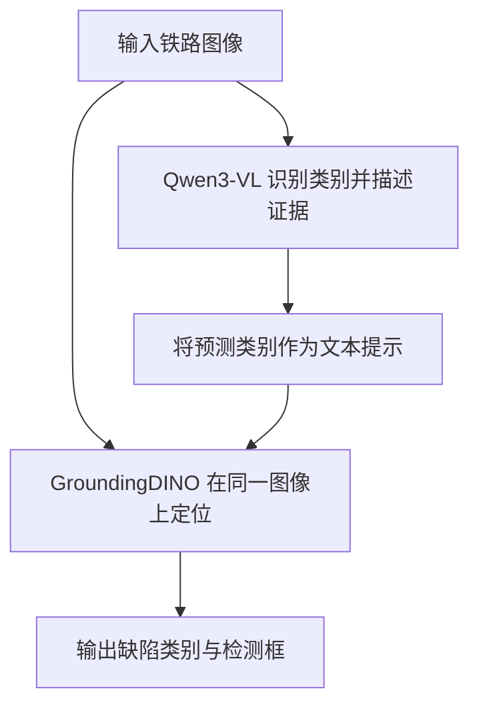

# RailMind 辅助阅读指南：从目录到完整工作流

第一次阅读本项目，建议先看本文，再进入 [01 工作流程](01_workflow.md)及后续分阶段教程。

RailMind 围绕论文 **RailMind: Multimodal Reasoning for Railway Infrastructure Security**，组织了一套从铁路图像构建监督数据，再训练模型、识别缺陷、定位和评测的研究工作流。

核心分工是：**Qwen3-VL 判断“有什么缺陷、依据是什么”，GroundingDINO 判断“缺陷在哪里”。** 两个组件分别训练，在推理时串联。

## 1. 先看目录：每部分负责什么

| 目录或文件 | 作用 | 阅读重点 |
|---|---|---|
| [README.md](../README.md) | 项目入口 | 方法、快速开始与完整流程 |
| [docs/](.) | 分阶段教程 | 每一步的目的、输入输出与命令 |
| [railmind/](../railmind) | 项目核心代码 | 数据、增强、训练适配、推理与评测 |
| [configs/](../configs) | 实验配置 | 学习率、批量、epoch、LoRA、GRPO/GSPO 参数 |
| [prompts/](../prompts) | 提示词 | 教师如何分析图像、增强如何编辑缺陷 |
| [training/](../training) | 训练插件 | 铁路类别奖励如何接入 RL 框架 |
| [third_party/](../third_party) | 第三方源码快照 | 实际保留的训练框架实现及来源 |
| [tests/](../tests)、[scripts/](../scripts) | 验证工具 | 工作流测试、发布检查与源码整理 |

先读文档，再沿文档找核心代码。研究底层优化或模型实现时，再进入第三方框架。

统一命令入口是 [railmind/cli.py](../railmind/cli.py)。例如，`python -m railmind annotate` 会转到教师标注实现，`python -m railmind evaluate` 会转到评测实现。

## 2. 数据准备：把已有图像整理成统一记录

对应 [02 数据规范](02_data.md)，主要实现是 [railmind/data.py](../railmind/data.py)和 [railmind/schema.py](../railmind/schema.py)。

原始材料可能包括铁路图像、人工类别标签和 COCO 检测框。项目先把它们整理为 **manifest，即图像清单**。每条记录说明：

- 图像位置、尺寸和场景。
- 属于训练、验证还是测试集。
- 已有的人工缺陷类别与框。
- 图像哈希，用于检查图像是否变化以及是否跨集合重复。

对应命令为 `manifest → verify → leakage`。

这一步让后续模块使用同一套数据约定，并检查图像或增强来源是否混入评测集。按采集批次、线路、序列或来源分组划分，应在教师标注和增强之前完成；哈希检查不能替代对近重复图像的来源审查。

**实际训练集、评测集及其清单均留在私有环境。GitHub 提供数据处理方法，不提供这些数据。**

## 3. 教师标注：生成理解任务所需的描述监督

对应 [03 大模型教师标注](03_data_engine.md)，核心实现是 [railmind/api.py](../railmind/api.py)。

人工标注可能只告诉我们一张图像属于 `noclip`（弹条缺失）。为了训练视觉语言模型，还需要图像与回答配对，例如下面这段虚构说明：

> 图像中可见轨道扣件位置存在弹条缺失，缺失部位与邻近正常扣件形成对比。

教师模型根据图像和领域提示词生成类别、可见证据与风险描述，经过人工审核后再成为训练监督：

`annotate → review → export-sft`

阅读 `api.py` 时，可依次看提示词与图像如何组织为请求、结果如何解析、进度如何保存，以及更换图像或提示词后如何避免误用旧输出。

需要区分两种监督：**教师描述帮助 Qwen 学会理解和表达；人工检测框帮助检测器学会定位。** 教师生成的类别和坐标不能自动当作人工真值。

## 4. 数据增强：用 NanoBanana 补充长尾缺陷

对应 [04 同场景数据增强](04_augmentation.md)，核心实现是 [railmind/augment.py](../railmind/augment.py)。

某些缺陷样本较少，项目利用“背景图＋缺陷参考图”生成新训练图像。例如，选择轨道背景和弹条断裂参考图，尝试在对应部件上合成断裂缺陷。

流程为：

`plan-augment → augment → collect-augment → review`

- `plan-augment`：按场景、目标类别和配额规划背景/参考配对。
- `augment`：提交生成任务，保存任务 ID 并轮询。
- `collect-augment`：整理生成图像与来源记录。
- `review`：确认实际缺陷与类别，决定是否保留。

过程记录来源哈希、提示词、模型和任务 ID，方便追溯与续接。**要求生成某类缺陷，不等于图像里确实存在该缺陷。** 生成后仍需审核；检测器训练所需的框也需重新标注，不能直接沿用编辑前的框。

## 5. 模型训练：理解与定位两条分支

对应 [05 SFT 与检测器训练](05_training.md)。

| 分支 | 使用的监督 | 学习目标 |
|---|---|---|
| Qwen3-VL SFT | 图像＋审核后的描述及类别回答 | 识别铁路缺陷、解释证据、遵循输出格式 |
| GroundingDINO | 图像＋人工确认类别及检测框 | 将文本指定的缺陷定位到图像区域 |

[railmind/training.py](../railmind/training.py)检查输入、解析配置并组织启动命令；底层优化由 LLaMA-Factory、Open-GroundingDino 等框架执行。对应配置分别位于 `configs/sft/` 和 `configs/dino/`。

两套 SFT 实验必须区分：

- 论文配置：**20,931 条描述监督**。
- 后续服务器配置：增加 **3,334 条框输出样本**，共 **24,265 条混合监督**。

它们是不同实验版本，不能用混合监督结果直接解释描述监督方法。

## 6. 可选 RL：进一步优化最终类别选择

对应 [06 类别集合强化学习](06_rl.md)。

SFT 模型能稳定遵循任务格式后，可以探索 GRPO/GSPO。当前奖励只比较最终类别集合：

| 最终预测情况 | 奖励 |
|---|---:|
| 类别集合完全正确 | 1 |
| 包含全部正确类别，但额外多报 | 0.5 |
| 漏报、未知类别或最终格式错误 | 0 |

例如真值只有“弹条缺失”：完全一致得 1；预测“弹条缺失＋鸟巢”得 0.5；只预测“鸟巢”得 0。

奖励计算见 [railmind/reward.py](../railmind/reward.py)，框架插件见 [training/railway_reward.py](../training/railway_reward.py)，参数见 `configs/rl/`。

这个阶段优化类别决策，不直接优化检测框坐标。超集奖励可能鼓励多报，因此同时看完全匹配率、精确率、召回率及超集比例，不能只看平均奖励。

原始铁路专用 RL 启动脚本和精确历史数据尚未完全恢复；当前启动配置标为重建起点。

## 7. 联合推理：先识别类别，再定位

对应 [07 推理与评测](07_evaluation.md)。

命令主线为 `semantic → ground → evaluate`：

- `semantic`：调用配置好的模型服务，得到类别预测。
- `ground`：用预测类别驱动检测器，输出原图像素坐标框。
- `evaluate`：读取预测与私有真值，计算指标。

核心代码在 [railmind/grounding.py](../railmind/grounding.py)。**检测器接收的是 Qwen 预测类别，不能提前把测试真值类别告诉它。** 真值类别提示只能作为单独标记的理想上界实验。

模型服务需另行部署并配置，仓库中的 API 适配器本身不是模型推理服务端。

## 8. 评测：区分类别识别和定位能力

核心实现是 [railmind/evaluation.py](../railmind/evaluation.py)。

分类检查图像中的缺陷类别是否正确；检测还要求类别正确、预测框与真值框达到指定 IoU。重复框计为假阳性。

结果分别报告类别宏平均、实例微平均和场景平均，不混用不同汇总口径。固定 IoU 下的精确率不等于 COCO AP/mAP。

消融实验回答每个环节是否有效：

- 基座模型与领域 SFT 相比如何？
- SFT 加上 GRPO/GSPO 后是否改善？
- 增强数据是否帮助长尾类别？
- 直接要求大模型输出框，与理解引导定位相比如何？
- 预测类别提示与全类别提示相比如何？

阈值应在验证集选择，测试集用于最终评测。

## 9. 复现与知识板块：结果能说明什么

[08 复现审计](08_reproducibility.md)记录恢复材料、版本差异和验证边界。当前 CPU 工作流与发布 CI 已通过；完整 GPU 训练、真实 API 调用和论文指标尚未在本次源码整理中重新验证。

文档记录的完整私有基准为 820 张图像；810 是显式派生的比较子集，历史原始版本尚未独立找回。

接着可阅读：

- [09 SFT/RL 技能图谱](09_sft_rl_skills_and_community.md)：将代码步骤与后训练技能、工具链联系起来。
- [10 论文路线与曲线解读](10_post_training_paper_roadmap.md)：理解论文脉络、loss/reward/KL 等信号，以及如何安排调参实验。
- [验证记录](VALIDATION.md)：区分已通过的工程检查和尚未验证的训练环节。

## 10. 建议阅读顺序

第一次读项目，按下面的顺序建立整体认识：

**本文 → 工作流程 → 数据规范 → 教师标注 → 数据增强 → SFT/检测器训练 → 可选 RL → 推理评测 → 复现审计 → 知识扩展。**

阅读代码时，从 `railmind/cli.py` 找命令分发，再进入对应模块。先理解每一步的输入、输出及审核条件，最后研究第三方框架内部实现。

如果只是先体验工作流，可以按首页运行 `python -m railmind demo --output outputs/demo`。该示例使用程序生成的虚构图像，无需 GPU、权重或 API Key，输出指标不是论文结果。真实 API、训练和定位命令默认只预览，加 `--execute` 才实际执行。
