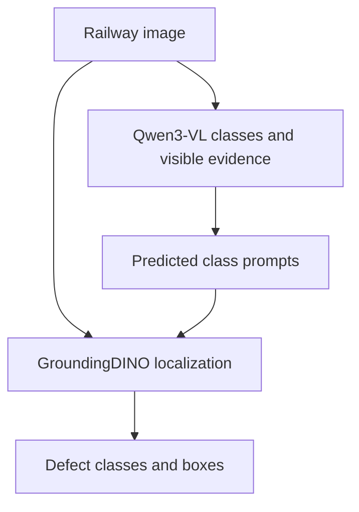

# RailMind reading guide: from repository layout to the full workflow

[English](../README.md) · [简体中文](zh-CN/00_reading_guide.md)

[English homepage](../README.md) · [Chinese homepage](../README.zh-CN.md) · [Core code](../railmind/)

This is the technical entry point linked from the README. The homepage presents the authors, method, public illustrations and research highlights; this guide connects those concepts to implementation and stage-by-stage tutorials.

## Choose an entry point

| Goal | Start here | Outcome |
|---|---|---|
| Try the workflow | [Quick start](../README.md#quick-start) | CPU demo without a GPU, weights or API key |
| Understand the method | [Full workflow](01_workflow.md) | Data engine, SFT, optional RL and understanding-guided localization |
| Prepare authorized data | [Data conventions](02_data.md) | Manifests, annotations, splits and leakage checks |
| Build supervision | [Teacher annotation](03_data_engine.md), [augmentation](04_augmentation.md) | Generate, track and review training material |
| Train and post-train | [SFT/detector training](05_training.md), [RL](06_rl.md) | Choose a recipe and prepare the appropriate environment |
| Run inference | [Inference and evaluation](07_evaluation.md) | Semantic predictions, boxes and explicit metrics |
| Audit evidence | [Reproducibility audit](08_reproducibility.md) | Provenance, version differences and validation limits |

Homepage highlights follow the manuscript abstract: approximately 31% precision improvement, 19% recall improvement and 37% classification macro-F1 improvement. See the homepage table for tasks and comparisons. CPU demo metrics are not paper results.

## 1. Repository layout

| Path | Responsibility | Reading focus |
|---|---|---|
| [README.md](../README.md) | Research entry point | Method, results and quick start |
| [docs/](.) | Stage-by-stage tutorials | Purpose, inputs, outputs and commands |
| [railmind/](../railmind) | Core workflow | Data, augmentation, training adapters, inference and evaluation |
| [configs/](../configs) | Experiment recipes | Learning rate, batch size, epochs, LoRA and RL settings |
| [prompts/](../prompts) | Teacher and editing prompts | Image analysis and defect synthesis |
| [training/](../training) | Framework plugins | Railway class-set reward |
| [third_party/](../third_party) | Framework snapshots | Retained implementations and provenance |
| [tests/](../tests), [scripts/](../scripts) | Validation and release tools | Workflow tests, scanning and assembly |

Start with documentation, then follow links into the core code. Inspect upstream frameworks when you need optimizer or model implementation details. The command dispatcher is [railmind/cli.py](../railmind/cli.py): `annotate` enters teacher annotation, and `evaluate` enters evaluation.

RailMind combines Qwen3-VL, which identifies defects and describes visible evidence, with GroundingDINO, which localizes them. The components train independently and connect during inference.

## 2. Prepare data

Read [data conventions](02_data.md), [data.py](../railmind/data.py) and [schema.py](../railmind/schema.py).

Convert images, class labels and COCO boxes into a manifest containing image paths, dimensions, scenes, splits, labels, boxes and hashes. The command sequence is `manifest → verify → leakage`.

Group splits by acquisition batch, route, sequence or provenance before teacher annotation or augmentation. Hash checks find exact duplicates and recorded lineage leakage; they do not replace a provenance review for near duplicates. Training/evaluation data and their manifests remain private.

## 3. Generate teacher supervision

Read [teacher annotation](03_data_engine.md) and [api.py](../railmind/api.py).

A manual `noclip` label identifies a missing rail clip; SFT additionally needs an image-response pair describing visible evidence. For example, a fictional response might explain that a missing clip contrasts with neighboring intact fasteners.

The workflow is `annotate → review → export-sft`. Inspect request construction, parsing, progress saving and resume validation. Teacher descriptions train understanding and expression; manually verified boxes train localization. Teacher-generated classes and coordinates are not automatically ground truth.

## 4. Augment rare defects

Read [same-scene augmentation](04_augmentation.md) and [augment.py](../railmind/augment.py).

Pair a training background with a same-scene defect reference. A broken rail clip should be synthesized on a rail fastener rather than on an unrelated barrier panel.

The workflow is `plan-augment → augment → collect-augment → review`:

- Plan source pairs, target classes and quotas.
- Submit generation and persist the accepted task ID.
- Collect images and provenance into a pending-review manifest.
- Verify actual defects and accept or reject each result.

Record source hashes, prompts, models and task IDs. A requested defect is not proof that the image contains it. Review generated images and annotate detector boxes again after editing.

## 5. Train understanding and localization

Read [training](05_training.md).

| Branch | Supervision | Objective |
|---|---|---|
| Qwen3-VL SFT | Images and reviewed descriptions/classes | Recognize defects, explain evidence and follow the output format |
| GroundingDINO | Images, verified classes and instance boxes | Localize text-specified defects |

[training.py](../railmind/training.py) validates inputs, resolves recipes and constructs launch commands; LLaMA-Factory and Open-GroundingDino perform optimization.

Keep the paper's 20,931 description-supervision records separate from the later 24,265-record mixture, which adds 3,334 box-output samples. Results from these settings answer different questions.

## 6. Optional class-set RL

Read [reinforcement learning](06_rl.md).

Introduce GRPO/GSPO after SFT reliably follows the output format. The reward compares final class sets:

| Prediction | Reward |
|---|---:|
| Exact match | 1 |
| Strict superset of the correct classes | 0.5 |
| Missing classes, unknown classes or invalid final format | 0 |

If ground truth is only `noclip`, the same set earns 1, `noclip + nest` earns 0.5, and `nest` earns 0. The implementation is [reward.py](../railmind/reward.py), with the [framework plugin](../training/railway_reward.py) and recipes in `configs/rl/`.

This stage optimizes class decisions, not box coordinates. Superset rewards can encourage overprediction: track exact match, precision, recall and superset frequency alongside mean reward. The historical railway launch script and exact prompt set have not been fully recovered; current recipes are reconstructed starting points.

## 7. Joint inference

Read [inference and evaluation](07_evaluation.md).

The sequence is `semantic → ground → evaluate`. Semantic inference calls a separately deployed model service. Grounding uses predicted classes and outputs original-image pixel boxes; evaluation compares predictions with private ground truth.

[grounding.py](../railmind/grounding.py) must not receive test ground-truth classes as normal inference prompts. Oracle-class prompting is a separately labeled upper-bound experiment. The API adapter is not a model-serving backend.

## 8. Evaluation and ablations

Read [evaluation.py](../railmind/evaluation.py). Classification checks image-level classes; detection additionally requires same-class IoU matching. Duplicate detections count as false positives.

Report class-macro, instance-micro and scene-average metrics separately. Precision at a fixed IoU is not COCO AP/mAP. Select thresholds on validation data and reserve test data for final evaluation.

Ablations should compare the base model with domain SFT, SFT with GRPO/GSPO, original data with reviewed augmentation, direct VLM boxes with understanding-guided localization, and predicted-class prompts with all-class prompts.

## 9. Evidence and further study

The [reproducibility audit](08_reproducibility.md) records recovered materials, versions and validation boundaries. CPU workflow checks do not establish successful GPU training, real API execution or reproduction of paper metrics.

The audited private benchmark contains 820 images; 810 refers to an explicitly derived comparison subset whose historical original annotation file has not been independently recovered.

Continue with the [SFT/RL skills guide](09_sft_rl_skills_and_community.md), the [post-training reading roadmap](10_post_training_paper_roadmap.md), and [validation records](VALIDATION.md).

## 10. Suggested reading order

This guide → workflow → data → teacher supervision → augmentation → SFT/detector training → optional RL → inference/evaluation → reproducibility → further study.

Follow commands from `railmind/cli.py` into their modules. Understand inputs, outputs and review conditions before inspecting upstream internals.

For a first trial, run `python -m railmind demo --output outputs/demo`. It generates fictional images without a GPU, weights or credentials. Real API, training and grounding commands preview by default; add `--execute` to run them.
